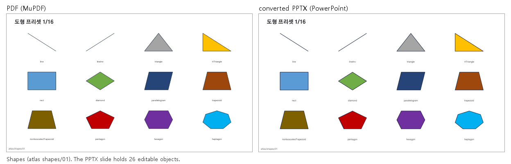

# deckback

한국어 | [English](#english)

**PDF를 고칠 수 있는 PowerPoint(.pptx)로 바꿉니다.** 글상자, 도형, 선, 그림, 그라데이션을 PDF에서 읽어 PowerPoint 안에서 선택하고 고칠 수 있는 개체로 다시 만듭니다. 그림 한 장으로 붙여 넣는 방식이 아닙니다.

**파일은 컴퓨터 밖으로 나가지 않습니다.** 변환은 모두 내 컴퓨터(웹 사이트에서는 내 브라우저)에서 이루어집니다. 서버에 올리지 않고, 인터넷이 막힌 곳에서도 같은 결과가 나옵니다.



위 그림은 우리가 직접 만든 시험 덱(CC0)의 한 쪽입니다. 왼쪽은 입력 PDF를 MuPDF로 그린 것이고, 오른쪽은 변환한 PPTX를 PowerPoint가 그린 것입니다. 그림 아래에 그 슬라이드에 든 고칠 수 있는 개체의 수를 적었습니다. 다른 예: [채우기와 그라데이션](docs/images/compare-fills.png), [글자](docs/images/compare-text.png), [표](docs/images/compare-table.png). 이 그림들은 PowerPoint의 화면 캡처가 아니라 두 그림을 나란히 놓은 것입니다.

## 쓰는 방법 세 가지

> **npm 꾸러미와 웹 사이트는 준비 중입니다.** 아직 npm에 올리지 않았고 사이트도 배포하지 않았습니다. `npx deckback`은 npm에 올린 뒤부터 되고, 공개 주소도 아직 없습니다. 지금은 아래처럼 소스나 직접 만든 꾸러미로 씁니다. 저장소: <https://github.com/hakm12-ship-it/deckback>

1. **웹 사이트(준비 중).** `apps/web`은 PDF를 끌어다 놓으면 브라우저 안에서 변환하고 PPTX를 내려받는 정적 사이트입니다. 한 번 열면 오프라인에서도 돌아갑니다. 공개 주소는 아직 없고, 지금은 내 컴퓨터에서 띄웁니다.

   ```
   npm ci
   npm run dev --workspace apps/web
   ```

   또는 `npm run build --workspace apps/web` 다음 `npm run preview --workspace apps/web`.
2. **명령어.** Node.js 22.13 이상이 필요합니다. 옵션은 [packages/cli/README.md](packages/cli/README.md)에 있습니다.
   - **소스에서 바로(지금 쓸 수 있음).** 저장소를 받아 빌드합니다.

     ```
     git clone https://github.com/hakm12-ship-it/deckback.git
     cd deckback
     npm ci
     npm run build:cli
     node packages/cli/dist/deckback.mjs in.pdf -o out.pptx --report r.json
     ```
   - **직접 만든 꾸러미로(지금 쓸 수 있음).** 위처럼 `npm ci`와 `npm run build:cli`를 한 뒤 꾸러미(tarball)를 만들어 `npx`로 돌립니다.

     ```
     npm pack -w packages/cli
     npx --yes --package ./deckback-1.0.0.tgz -- deckback in.pdf -o out.pptx --report r.json
     ```
   - **npm에서(준비 중, 올린 뒤부터).** `npx deckback@1.0.0 in.pdf -o out.pptx`. 아직 npm에 없어서 지금은 되지 않습니다.
3. **Claude Code 스킬.** [skills/pdf-to-pptx](skills/pdf-to-pptx/README.md) 폴더를 `.claude/skills/`에 복사하면, Claude Code가 위 명령어를 대신 돌리고 변환 보고서를 한국어로 풀어 줍니다. npm에 올리기 전에는 `DECKBACK_NPX_SPEC`에 위 꾸러미 경로를 지정해야 합니다(스킬 README 참고). Claude는 PDF와 PPTX를 열어 보지 않습니다.

## 실제로 얼마나 잘 되나: 잰 숫자

"통과"는 슬라이드 하나가 엄격한 자동 검사를 모두 넘은 것입니다. PDF와 PowerPoint가 그린 화면을 화소로 비교하고(V1, V2), 변환한 PPTX를 PowerPoint가 다시 내보낸 PDF와 구조(글자, 글꼴, 크기, 색, 도형, 그림, 순서)를 비교합니다(S1~S7). 통과하지 못한 슬라이드가 틀려 보인다는 뜻은 아닙니다. 방법과 규칙은 [docs/decisions/0011-m8-real-pdf-gate.md](docs/decisions/0011-m8-real-pdf-gate.md)에 있습니다.

| 단계 | 무엇을 쟀나 | 결과 |
|---|---|---|
| **A단** (우리가 만든 시험 덱) | 기능 지도(atlas)와 쪽 크기 덱: 도형, 선, 채우기, 효과, 글자, 표, 차트, 그림, 배경. 모두 우리 하네스가 만든 CC0 자료다. 10개 덱·변형, 350장 | 231장 통과(66.0 %) |
| **B단** (공개된 실제 PDF, PowerPoint (Windows)가 낸 것) | Zenodo, NASA NTRS, 공공누리의 공개 덱 200개 가운데 PowerPoint (Windows) 출신 71개, 1,781장 | **1,115장 통과(62.6 %)**, 666장은 통과하지 못함 |
| B단 가운데 위치 확인 통과 | 화소는 글자 위치가 몇 십분의 1 pt 다르지만, PowerPoint가 다시 내보낸 PDF에서 모든 글자가 PDF의 위치에서 0.25 pt 안에 있는 슬라이드 | 39장. 1,115장 가운데 이 39장을 빼면 **1,076장은 검사만으로 통과** |
| B단 200개 덱 전부 | PowerPoint (Windows) 출신이 아닌 129개 덱도 변환하고 PowerPoint에서 열어 복구 창이 뜨는지 봄(화면은 비교하지 않음) | **변환 충돌 0, PowerPoint 복구 창 0** |
| **C단** (작성자 한 사람의 덱, Acrobat PDFMaker 출신) | 한 덱, 21장. 보고만 하고 약속하지 않는다 | 12장 통과 |

- A단은 우리가 만든 자료라서 B단보다 쉬운 시험입니다. 약속하는 숫자는 B단입니다.
- B단의 통과 숫자 가운데는 글꼴 예외가 있습니다. PDF가 글꼴을 넣지 않았거나 측정한 PC의 글꼴 판이 달라서 화소 비교를 일부 빼고 판정한 슬라이드입니다. 자세한 내용은 0011에 있습니다.
- C단은 덱 한 개라서 통계가 아니라 한 사례입니다.
- 한국어 PowerPoint (Windows) 덱은 공개 표본에 없어서 시험하지 못했습니다.

## 약속하는 범위(PDF를 만든 프로그램)

**약속하는 것은 PowerPoint (Windows)가 "PDF로 저장"한 PDF입니다**(Office 2016 이후, Microsoft 365). 이 범위에서 위의 숫자를 쟀습니다.

Mac PowerPoint, 웹 PowerPoint, Google Slides, Keynote, LibreOffice, Acrobat PDFMaker, "PDF로 인쇄", 다시 압축하거나 다시 저장한 PDF와 그 밖의 프로그램은 약속하지 않습니다. 이런 PDF도 129개 덱에서 변환 충돌과 PowerPoint 복구 창 없이 변환되었고, 보고서에 무엇을 근사했는지 적히지만, 화면이 얼마나 같은지는 보고만 합니다. 소유자 암호만 걸린 PDF는 변환되지만 글꼴이 이름으로만 적힙니다. 사용자 암호가 있는 PDF는 변환하지 않습니다.

## 알려진 한계

1,781장 가운데 666장이 엄격한 검사를 통과하지 못했습니다. 주된 원인(장 수):

- **글자 위치가 0.1~1 pt 어긋남(345장).** PowerPoint가 글자를 직접 배치하므로 자간, 커닝, 낱말 사이가 PDF와 같을 수 없습니다. 글자는 고칠 수 있고 눈으로는 제자리에 있지만, 글리프 위치가 허용 오차 안에 들지 않습니다. 렌더러 잡음만 다른 19장이 따로 있습니다.
- **그림의 화소가 다름(121장).** PowerPoint가 그림을 다시 압축하거나 줄여 그립니다.
- **얇은 벡터 가장자리가 다름(51장), 일부 벡터 칠하기를 버림(30장), 길이 0인 점을 버림(10장).** 아이콘, 표 테두리, 윤곽 글자, 메타파일 그림.
- **PDF가 넣지 않은 글꼴(35장).** 글꼴을 이름으로만 적습니다. 어떻게 보일지는 쓰는 PC에 그 글꼴이 있는지에 달렸고, 없으면 PowerPoint가 다른 글꼴로 바꿉니다.
- **PowerPoint 다시 내보내기의 차이(29장).** 그 밖에 26장(그라데이션 위의 그림, 효과를 위한 통째 그림 몇 장 등).
- **이미지로만 된 PDF(스캔)** 는 글자를 읽지 않습니다(OCR 없음). 그 쪽은 그림으로 들어가고 보고서에 `image-only`로 적힙니다.

원인별 표와 판정 목록은 [docs/decisions/0011-m8-real-pdf-gate.md](docs/decisions/0011-m8-real-pdf-gate.md)의 "알려진 한계"에 있습니다.

## 개인정보

- 변환은 이 컴퓨터(웹에서는 이 브라우저) 안에서만 이루어집니다. 명령어는 네트워크를 쓰지 않고, 웹 사이트는 PDF를 어디로도 보내지 않습니다. (소스를 받을 때와 `npm ci`로 의존성을 받을 때만 네트워크를 씁니다. 변환 자체는 쓰지 않습니다.)
- 변환 보고서에는 쪽마다 개체 수, 근사한 것, 글꼴 이름, PDF를 만든 프로그램, 합계가 들어 있고 문서 본문의 글자는 들어 있지 않습니다.
- 사이트 빌드는 쿠키 없는 쪽 조회수 세기(Cloudflare Web Analytics)를 넣을 수 있게 되어 있고, 설정하지 않으면 꺼져 있습니다. 어느 쪽이든 PDF의 내용은 보지 않습니다.
- 이 저장소의 시험 자료는 우리가 만든 CC0 덱뿐이고, 실제 덱의 파일, 제목, 글자는 올리지 않습니다. 실제 PDF를 잰 결과에는 덱의 번호(해시)와 숫자만 있습니다.

## 라이선스

Apache-2.0입니다. [LICENSE](LICENSE)와 [NOTICE](NOTICE)를 보세요. npm 꾸러미(올린 뒤)에는 함께 들어 있는 제3자 소프트웨어(pdf.js, fflate)를 밝힌 NOTICE가 따로 들어 있습니다. 기여는 [CONTRIBUTING.md](CONTRIBUTING.md), 보안 제보는 [SECURITY.md](SECURITY.md), 바뀐 점은 [CHANGELOG.md](CHANGELOG.md)에 있습니다.

---

# English

[한국어](#deckback) | English

**deckback turns a PDF into an editable PowerPoint (.pptx).** It reads text boxes, shapes, lines, pictures and gradients from the PDF and rebuilds them as objects you can select and edit in PowerPoint, rather than pasting one picture per page.

**Your file never leaves your device.** The conversion runs entirely on your computer (in your browser, on the web site). Nothing is uploaded, and it gives the same result with the network blocked.


The picture is one page of our own test deck (CC0). Left: the input PDF drawn by MuPDF. Right: the converted PPTX drawn by PowerPoint. The caption says how many editable objects that slide holds. More: [fills and gradients](docs/images/compare-fills.png), [text](docs/images/compare-text.png), [a table](docs/images/compare-table.png). They are two renders side by side, not screenshots of PowerPoint's selection handles.

## Three ways to use it

> **The npm package and the web site are coming soon (not yet available).** The package is not on npm and the site is not deployed, so `npx deckback` does not work yet and there is no public address. For now, use it from source or from a package you pack yourself, as below. Repository: <https://github.com/hakm12-ship-it/deckback>

1. **The web site (coming soon).** `apps/web` is a static site: drop a PDF on it, it converts inside the browser and you download the PPTX. After one visit it also works offline. There is no public address yet; for now run it on your own computer.

   ```
   npm ci
   npm run dev --workspace apps/web
   ```

   Or `npm run build --workspace apps/web` followed by `npm run preview --workspace apps/web`.
2. **The command line.** Needs Node.js 22.13 or newer. Options: [packages/cli/README.md](packages/cli/README.md).
   - **From source (works now).** Clone and build:

     ```
     git clone https://github.com/hakm12-ship-it/deckback.git
     cd deckback
     npm ci
     npm run build:cli
     node packages/cli/dist/deckback.mjs in.pdf -o out.pptx --report r.json
     ```
   - **From a package you pack yourself (works now).** After `npm ci` and `npm run build:cli` as above, pack a tarball and run it with `npx`:

     ```
     npm pack -w packages/cli
     npx --yes --package ./deckback-1.0.0.tgz -- deckback in.pdf -o out.pptx --report r.json
     ```
   - **From npm (coming soon, after it is published).** `npx deckback@1.0.0 in.pdf -o out.pptx`. It is not on npm yet, so this does not work today.
3. **A Claude Code skill.** Copy [skills/pdf-to-pptx](skills/pdf-to-pptx/README.md) into `.claude/skills/` and Claude Code runs the command for you and explains the conversion report. Until the package is on npm, set `DECKBACK_NPX_SPEC` to the tarball path above (see the skill README). Claude does not open the PDF or the PPTX.

## What was measured, and how well it works

"Pass" means one slide cleared every strict automated check: a pixel comparison of the PDF's render against PowerPoint's (V1, V2), and a structural comparison (text, fonts, sizes, colours, shapes, pictures, order) of the PDF that PowerPoint exports again from the converted PPTX (S1 to S7). A slide that fails is not necessarily one that looks wrong. Method and rules: [docs/decisions/0011-m8-real-pdf-gate.md](docs/decisions/0011-m8-real-pdf-gate.md).

| Tier | What was measured | Result |
|---|---|---|
| **A** (our own test decks) | The feature atlas and the page-size decks: shapes, lines, fills, effects, text, tables, charts, pictures, backgrounds. All CC0, generated by our harness. 10 decks and variants, 350 slides | 231 slides pass (66.0 %) |
| **B** (public real PDFs exported by PowerPoint (Windows)) | 71 PowerPoint (Windows) decks among 200 public decks (Zenodo, NASA NTRS, Korean KOGL), 1,781 slides | **1,115 slides pass (62.6 %)**; 666 do not |
| of B, position-verified passes | Slides whose pixels differ by a few tenths of a point of text drift, but where PowerPoint's own re-export puts every letter within 0.25 pt of the PDF's | 39 slides. Without them, **1,076 of the 1,115 pass on the checks alone** |
| all 200 tier-B decks | The 129 decks that were not PowerPoint (Windows) were also converted and opened in PowerPoint to see whether a repair window appears (their pictures were not compared) | **0 crashes, 0 repair windows** |
| **C** (one author's decks, Acrobat PDFMaker) | One deck, 21 slides. Reported only, not promised | 12 slides pass |

- Tier A is made by us, so it is an easier test than tier B. The promise is tier B.
- Some tier-B passes are font exceptions: slides where the PDF does not embed a font, or the measuring PC has another version of it, judged without part of the pixel comparison. Details in 0011.
- Tier C is one deck: an example, not a statistic.
- Korean PowerPoint (Windows) decks were not in the public sample, so they are untested.

## What is promised: which producers

**The promise covers PDFs saved by PowerPoint for Windows** ("Save as PDF", Office 2016 or later, Microsoft 365). The numbers above were measured on them.

Mac PowerPoint, PowerPoint for the web, Google Slides, Keynote, LibreOffice, Acrobat PDFMaker, "Print to PDF", compressed or re-saved PDFs and everything else are not promised. They also converted without a crash or a PowerPoint repair prompt (129 decks) and the report says what was approximated, but how close the result looks is only reported. A PDF with an owner password only is converted, but its fonts are named by name alone. A PDF that needs a user password is not converted.

## Known limits

666 of 1,781 slides do not clear the strict checks. Main causes (slides):

- **Text sits 0.1 to 1 pt off (345).** PowerPoint lays text out itself, so letter spacing, kerning and word spacing cannot be the same as the PDF's. The text is editable and in the right place to the eye, but glyph positions miss the tolerance. 19 more slides differ only by renderer noise.
- **Pictures differ in pixels (121).** PowerPoint re-compresses or rescales some pictures.
- **Thin vector details differ (51), some vector paints are dropped (30), zero-length dots are dropped (10).** Icons, table borders, outlined WordArt, metafile pictures.
- **Fonts the PDF does not embed (35).** The typeface is written by name; how it looks depends on the PC having it, and PowerPoint replaces a missing one.
- **PowerPoint re-export differences (29),** and 26 others (pictures drawn over gradients, a few whole-page pictures for effects).
- **Image-only PDFs (scans)** are not read as text (no OCR). Such a page goes in as a picture and the report says `image-only`.

The cause table and the list of rulings are in "Known limits" of [docs/decisions/0011-m8-real-pdf-gate.md](docs/decisions/0011-m8-real-pdf-gate.md).

## Privacy

- The conversion runs only on this computer (in this browser, on the web site). The command line makes no network request, and the site sends the PDF nowhere. (Only fetching the source and `npm ci` use the network; the conversion itself does not.)
- The conversion report holds per-slide object counts, what was approximated, font names, the program that made the PDF and the totals, and none of the document's text.
- The site build can include a cookie-free page-view counter (Cloudflare Web Analytics); without a configured token it is off. Either way it never sees the contents of a PDF.
- The test material in this repository is only our own CC0 decks. No real deck's file, title or text is committed; the results measured on real PDFs hold a deck's number (a hash) and counts only.

## Licence

Apache-2.0. See [LICENSE](LICENSE) and [NOTICE](NOTICE); the npm package (once published) will carry its own NOTICE naming the third-party software bundled in it (pdf.js, fflate). Contributing: [CONTRIBUTING.md](CONTRIBUTING.md). Security reports: [SECURITY.md](SECURITY.md). Changes: [CHANGELOG.md](CHANGELOG.md).
